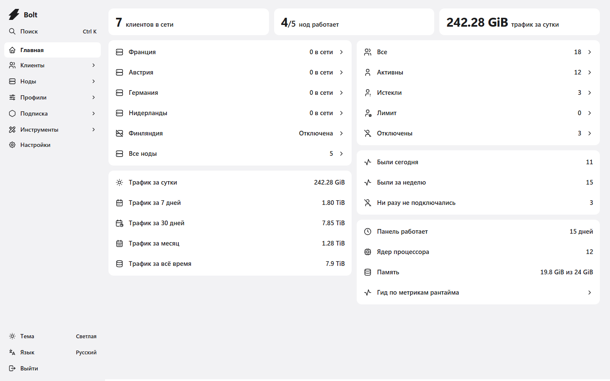
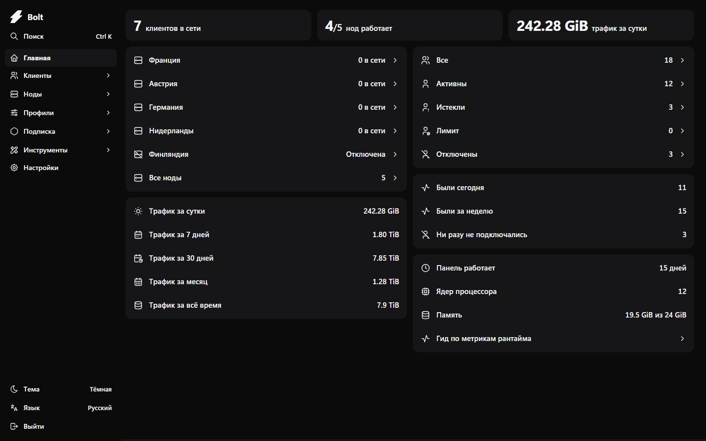
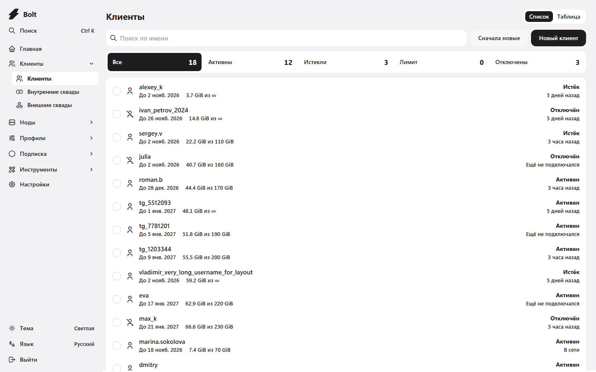
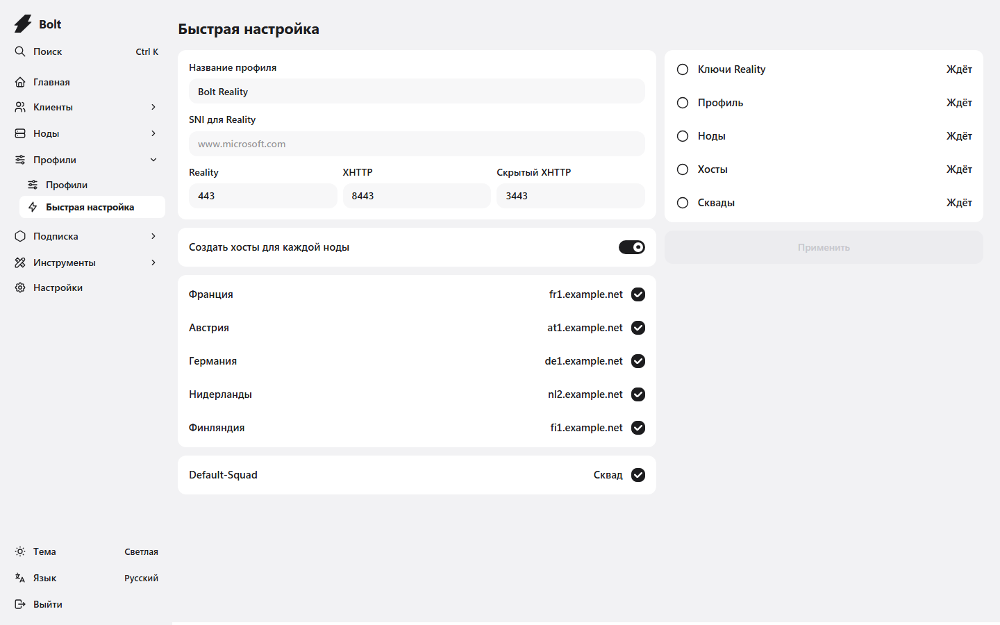
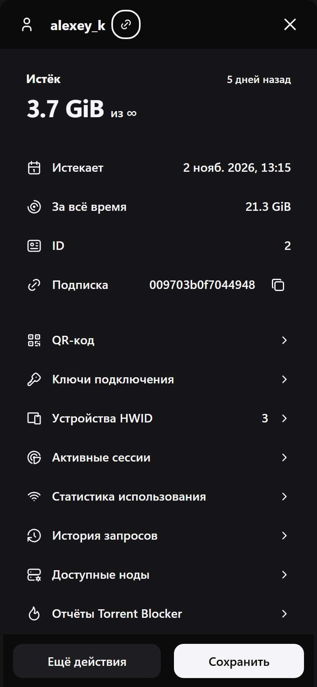
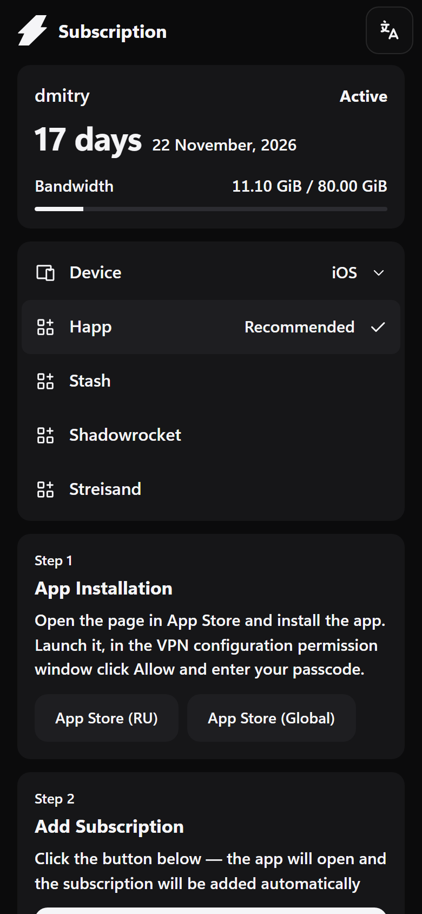
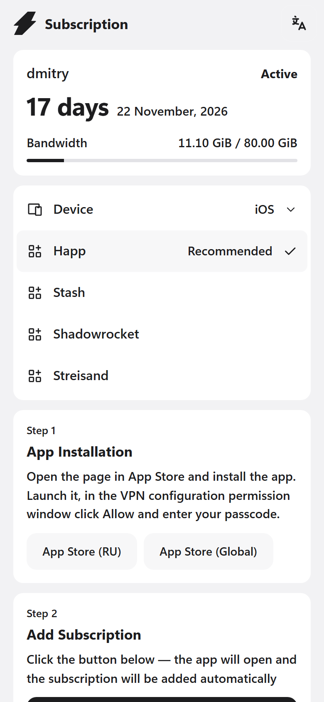

# Bolt

[Русский](README.md)

Bolt is a panel for Xray-based VPN services: users, nodes, hosts, profiles and the subscription page in one place. It is a fork of [Remnawave](https://github.com/remnawave) with a new interface, quick server setup and its own subscription page. The API and database stay compatible with Remnawave, and it uses the same nodes.



<details>
<summary>Dark theme</summary>



</details>

## Installation

A Linux x64 server and two domains pointing at it with A records: one for the panel, one for subscription links. As root:

```sh
curl -fsSL https://raw.githubusercontent.com/levvs-one/bolt/main/install.sh | sh
```

The script installs Docker if it is missing, asks for the two domains, generates passwords and secrets, and starts the panel, the database, Valkey and Caddy. Caddy issues the certificates itself. Everything lives in `/opt/bolt`, settings in `/opt/bolt/.env`.

After installation, open the panel and create the administrator. Then issue a token under Settings → API tokens and turn on the subscription page:

```sh
sh /opt/bolt/install.sh --subscription-token <token>
```

Nodes are installed the same way as for Remnawave: [remnawave/node](https://github.com/remnawave/node).

## What Bolt does

- **Everything at hand.** The home screen shows how many users are online, which nodes are running and how much traffic went through. `Ctrl K` opens any section or finds a user by name.
- **Users as a list, not a spreadsheet.** The status summary works as a filter, with search, sorting and bulk actions. The Remnawave table stays as a second view for complex filters.
- **User card.** State, traffic, expiry, subscription link and every action in one list: QR code, devices, sessions, request history.
- **Quick setup.** One form creates a profile with VLESS Reality on 443, XHTTP on 8443 and a hidden XHTTP on 3443 for fallback, generates the keys, attaches the chosen nodes, creates hosts and adds the inbounds to squads.
- **Subscription page.** The user first sees whether the subscription is active and how much is left, then picks a device and an app and follows the install steps. Light and dark themes follow the device.
- **Works from a phone.** On a phone the panel switches to bottom tabs, like an iOS app.
- **Everything else from Remnawave is still there:** squads, subscription templates, response rules, HWID, infrastructure billing, node plugins, API tokens, OAuth and passkey sign-in.

<details>
<summary>More screenshots</summary>





<p>



</p>

</details>

## Updating

```sh
cd /opt/bolt && docker compose pull && docker compose --profile subscription up -d
```

## Moving from Remnawave

Bolt uses the same database and the same `.env`. In the Remnawave `docker-compose.yml`, replace the `remnawave/backend:3` image with `ghcr.io/levvs-one/bolt:latest` and run `docker compose pull && docker compose up -d`. Back up the database first.

## Layout

| Directory | Contents |
|---|---|
| [`panel`](panel) | Web panel: React, Mantine, Vite |
| [`backend`](backend) | API: NestJS, Prisma, PostgreSQL, Valkey |
| [`subscription-page`](subscription-page) | The page behind subscription links |
| [`docker`](docker) | Builds of `ghcr.io/levvs-one/bolt` and `ghcr.io/levvs-one/bolt-subscription-page` |

Each directory is a subtree with the full history of the original Remnawave repository.

## Building from source

```sh
docker build -f docker/panel.Dockerfile -t bolt .
docker build -f docker/subscription-page.Dockerfile -t bolt-subscription-page .
```

Development needs Node.js 24, PostgreSQL 18 and Valkey. Run the panel with `npx vite` in `panel` and the backend with `npm run dev` in `backend`; the variables are described in each directory's `.env.sample`.

## License

[AGPL-3.0](LICENSE), same as Remnawave. If you run a modified Bolt for other people, you must publish the source of your changes.
