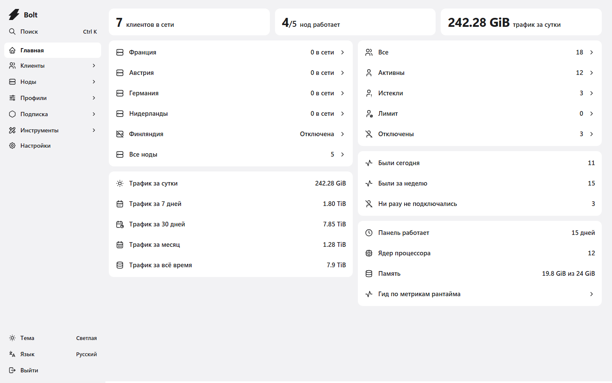
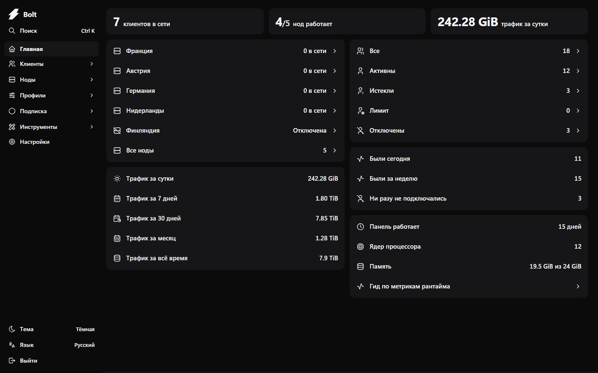
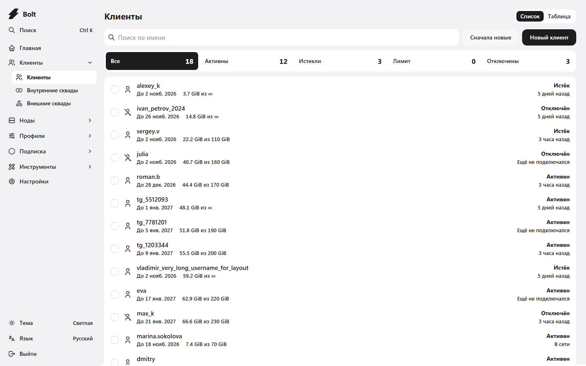
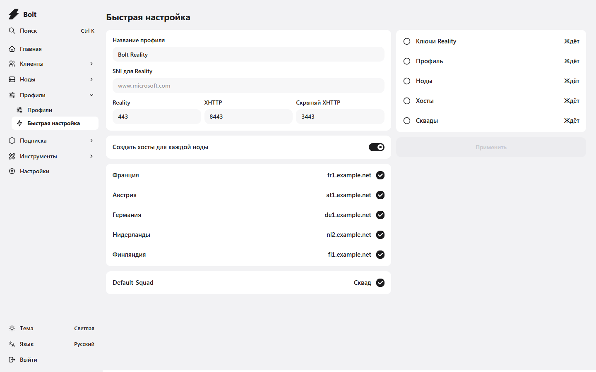
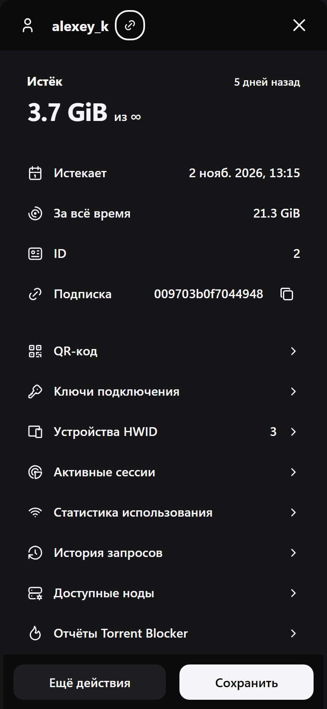
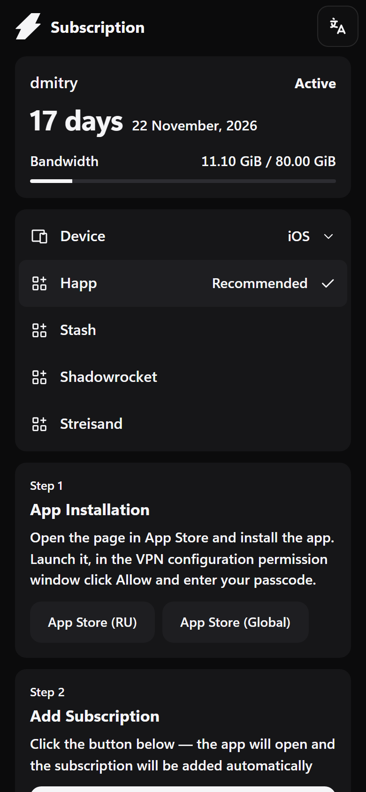
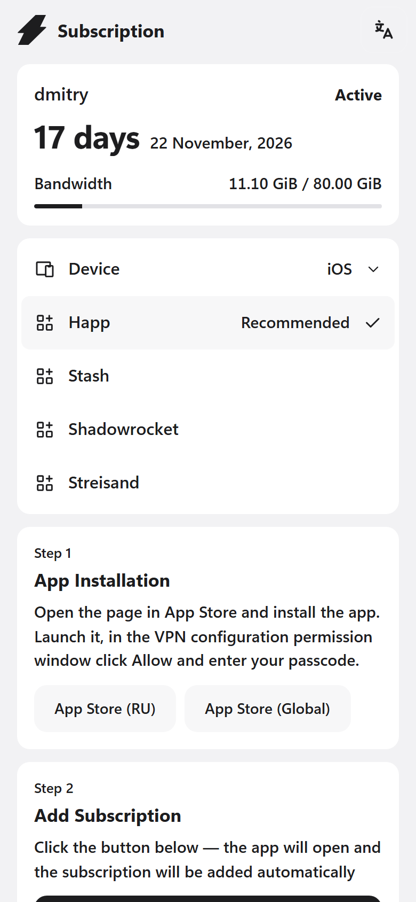

# Bolt

[English](README.en.md)

Bolt — панель для VPN на Xray: клиенты, ноды, хосты, профили и страница подписки в одном месте. Это форк [Remnawave](https://github.com/remnawave) с новым интерфейсом, быстрой настройкой серверов и своей страницей подписки. API и база данных совместимы с Remnawave, ноды подключаются те же.



<details>
<summary>Тёмная тема</summary>



</details>

## Установка

Сервер с Linux x64 и двумя доменами, которые смотрят на него A-записью: один для панели, другой для ссылок подписки. От root:

```sh
curl -fsSL https://raw.githubusercontent.com/levvs-one/bolt/main/install.sh | sh
```

Скрипт поставит Docker, если его нет, спросит два домена, сгенерирует пароли и секреты и запустит панель, базу, Valkey и Caddy. Сертификаты Caddy выпустит сам. Всё лежит в `/opt/bolt`, настройки — в `/opt/bolt/.env`.

После установки откройте панель, создайте администратора, затем выпустите токен в разделе «Настройки» → «Токены API» и подключите страницу подписки:

```sh
sh /opt/bolt/install.sh --subscription-token <токен>
```

Ноды ставятся так же, как для Remnawave: [remnawave/node](https://github.com/remnawave/node).

## Что умеет Bolt

- **Всё под рукой.** Главная показывает, сколько клиентов в сети, какие ноды работают и сколько ушло трафика. Поиск по `Ctrl K` открывает любой раздел или клиента по имени.
- **Клиенты списком, а не таблицей.** Сводка по статусам работает как фильтр, есть поиск, сортировка и массовые действия. Таблица Remnawave осталась вторым видом для сложных фильтров.
- **Карточка клиента.** Состояние, трафик, срок, ссылка подписки и все действия одним списком: QR-код, устройства, сессии, история запросов.
- **Быстрая настройка.** Одна форма создаёт профиль с VLESS Reality на 443, XHTTP на 8443 и скрытым XHTTP на 3443 для fallback, генерирует ключи, подключает выбранные ноды, создаёт хосты и добавляет входы в сквады.
- **Страница подписки.** Клиент сначала видит, активна ли подписка и сколько осталось, затем выбирает устройство и приложение и проходит шаги установки. Светлая и тёмная тема следуют настройкам устройства.
- **Удобно с телефона.** На телефоне панель переходит на нижние вкладки, как в приложениях iOS.
- **Остальное из Remnawave на месте:** сквады, шаблоны подписок, правила ответов, HWID, биллинг инфраструктуры, плагины нод, токены API и вход через OAuth и passkey.

<details>
<summary>Ещё скриншоты</summary>





<p>



</p>

</details>

## Обновление

```sh
cd /opt/bolt && docker compose pull && docker compose --profile subscription up -d
```

## Переход с Remnawave

Bolt работает с той же базой и тем же `.env`. В `docker-compose.yml` Remnawave замените образ `remnawave/backend:3` на `ghcr.io/levvs-one/bolt:latest` и выполните `docker compose pull && docker compose up -d`. Перед этим сделайте копию базы.

## Состав

| Каталог | Что внутри |
|---|---|
| [`panel`](panel) | Веб-панель: React, Mantine, Vite |
| [`backend`](backend) | API: NestJS, Prisma, PostgreSQL, Valkey |
| [`subscription-page`](subscription-page) | Страница по ссылке подписки |
| [`docker`](docker) | Сборка образов `ghcr.io/levvs-one/bolt` и `ghcr.io/levvs-one/bolt-subscription-page` |

Каждый каталог — поддерево с полной историей исходного репозитория Remnawave.

## Сборка из исходников

```sh
docker build -f docker/panel.Dockerfile -t bolt .
docker build -f docker/subscription-page.Dockerfile -t bolt-subscription-page .
```

Для разработки нужны Node.js 24, PostgreSQL 18 и Valkey. Панель запускается командой `npx vite` в `panel`, бэкенд — `npm run dev` в `backend`, переменные описаны в `.env.sample` каждого каталога.

## Лицензия

[AGPL-3.0](LICENSE), как у Remnawave. Если вы запускаете изменённый Bolt для других людей, исходный код изменений нужно открыть.
